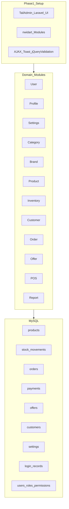

# SmartBiz – Architecture

## Overview

Modular Laravel app (`nwidart/laravel-modules`) with a **TailAdmin Laravel** admin shell. Single business, no multi-tenant tenancy. Inventory is product-level stock only.



## Module layering

```
Modules/{Name}/
  Http/Controllers, Requests, Middleware
  Services/
  Models/
  Policies/
  Enums/
  Database/Migrations, Seeders
  Resources/views, assets/css, assets/js
  Routes/web.php
  Providers/{Name}ServiceProvider.php
```

**Inside a module:** Controllers stay thin. Services own business rules. Form Requests validate writes. Policies + Spatie authorize. Models stay persistence-focused.

Shared app-level code in `app/` only when truly cross-module. Prefer module ownership. Optional `Core` module for JSON response helper, audit traits, shared utilities.

## Modules (do not merge Category / Brand / Product)

| Module | Owns | Depends on |
|---|---|---|
| User | User CRUD, role assignment | Spatie |
| Profile | Own profile + login records | User / auth |
| Settings | Currency + theme | — |
| Category | Categories | — |
| Brand | Brands | — |
| Product | Products, UPC check | Category, Brand |
| Inventory | Stock movements, adjust | Product |
| Customer | Customers, Walk-in | — |
| Order | Orders, items, cancel, invoice | Product, Customer, Inventory |
| Offer | Offers, usages, calc | Product, Category |
| Pos | POS UI + checkout | Product, Inventory, Customer, Order, Offer, Settings |
| Report | Widgets, reports, exports | Orders, Payments, Stock, Products |
| Core (opt.) | Shared helpers | — |

## UI shell (TailAdmin)

- All admin pages extend TailAdmin layouts (`resources/views/layouts`, Blade UI components).
- Auth uses TailAdmin guest/auth layouts (Breeze scaffolding only if needed — restyle to TailAdmin; no second admin chrome).
- Shared JS/CSS: toast, AJAX helpers, jQuery Validation defaults on TailAdmin Vite entry (`resources/js/app.js`, `resources/css/app.css`).
- Settings theme color maps to TailAdmin primary CSS variables (Tailwind v4 tokens).
- Per-module assets under `Modules/{Module}/Resources/assets/` — do not fork a second admin theme.
- POS may use a TailAdmin full-width layout variant; forms still AJAX + jQuery Validation.
- Charts: TailAdmin patterns preferred; Chart.js allowed in Report module.

## Auth & authorization

- Spatie Laravel Permission; middleware on routes **and** permission-gated TailAdmin nav.
- Seeded roles: Super Admin, Admin, Inventory Manager, Supervisor, Cashier.
- Permissions include: `users.*`, `products.*`, `categories.*`, `brands.*`, `inventory.view`, `inventory.adjust`, `orders.*`, `customers.manage`, `offers.manage`, `reports.view`, `pos.access`, `settings.manage`.
- Profile edit + view-own login records: all authenticated users (no special admin permission). Password change requires current password.

## Single-device login

1. On successful login: set `session_version` / `current_session_id` on user; invalidate other sessions (`SESSION_DRIVER=database` preferred — delete `sessions` rows by `user_id`).
2. Middleware on authenticated routes: mismatch → logout + redirect/toast (“Signed in on another device”).
3. Write `login_records` for success (and failed attempts when practical).

## Settings

- Key/value (or typed) `settings` table; seed defaults e.g. INR / ₹ / before, theme `#0F766E`.
- Money formatting helper reads currency settings for UI, invoices, reports, POS. Storage remains `decimal`.

## Stock model (no warehouse)

- Source of truth: `products.stock_quantity`.
- Every change: `stock_movements` row inside DB transaction with `lockForUpdate`.
- Types: `in`, `out`, `adjustment`, `sale`, `sale_reversal`.

## AJAX response contract

```json
{
  "success": true,
  "message": "...",
  "data": {},
  "errors": {}
}
```

Validation failures: HTTP 422, `success: false`, field `errors`. Toasts for feedback. Loading indicator while request in flight.

## Cross-cutting packages

| Package | Use |
|---|---|
| `spatie/laravel-permission` | Roles & permissions |
| `nwidart/laravel-modules` | Module structure |
| `barryvdh/laravel-dompdf` | Invoices / report PDFs |
| `maatwebsite/excel` | Excel exports |
| Pest + Pint | Tests + formatting |
