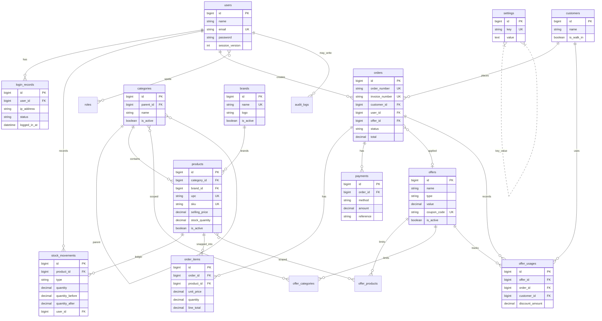

# SmartBiz – Database Design

MySQL 8. Normalized. **No warehouses.** Money: `decimal(12,2)`. Qty: `decimal(12,3)`. Soft deletes where noted.

## Table list

| Table | Module / owner | Purpose |
|---|---|---|
| `users` | User / auth | Accounts + single-device session fields |
| `sessions` | Laravel | DB sessions (preferred for single-device logout) |
| `password_reset_tokens` | Laravel | Password reset |
| `roles`, `permissions`, `model_has_roles`, `model_has_permissions`, `role_has_permissions` | Spatie | RBAC |
| `login_records` | Profile | Login history |
| `settings` | Settings | Currency + theme (+ future keys) |
| `categories` | Category | Product categories (optional parent) |
| `brands` | Brand | Brands |
| `products` | Product | Catalog + `stock_quantity` |
| `stock_movements` | Inventory | Stock ledger |
| `customers` | Customer | Customers (incl. Walk-in) |
| `orders` | Order | Sales orders |
| `order_items` | Order | Line items (price snapshots) |
| `payments` | Order / Pos | Payment rows |
| `offers` | Offer | Discounts / coupons |
| `offer_products` | Offer | Product scope |
| `offer_categories` | Offer | Category scope |
| `offer_usages` | Offer | Usage ledger |
| `audit_logs` | Core / Wave 7 | Audit trail |

## Key columns, FKs, indexes

### users
| Column | Notes |
|---|---|
| `id` | PK |
| `name`, `email` (unique), `password` | Profile-editable |
| `session_version` or `current_session_id` | Single-device enforcement |
| `is_active`, timestamps | |
| Spatie relations | via pivot tables |

### login_records
| Column | Notes |
|---|---|
| `id` | PK |
| `user_id` | FK → users, nullable for unknown failed email lookups if used |
| `ip_address`, `user_agent` | |
| `logged_in_at` | |
| `status` | `success` / `failed` |
| `session_id` | optional |
| **Index** | `(user_id, logged_in_at)` |

### settings
| Column | Notes |
|---|---|
| `id` | PK |
| `key` | unique (e.g. `currency.code`, `currency.symbol`, `currency.decimals`, `currency.position`, `theme.color`) |
| `value` | string/text |
| timestamps | |

Seed defaults: currency INR / ₹ / 2 / before; theme `#0F766E`.

### categories
| Column | Notes |
|---|---|
| `id` | PK |
| `parent_id` | nullable FK → categories |
| `name`, `slug` (optional), `is_active` | |
| soft deletes, timestamps | |

### brands
| Column | Notes |
|---|---|
| `id` | PK |
| `name` | unique |
| `logo` | nullable path |
| `is_active` | |
| soft deletes, timestamps | |

### products
| Column | Notes |
|---|---|
| `id` | PK |
| `category_id` | FK → categories |
| `brand_id` | nullable FK → brands |
| `name`, `description` | |
| `upc` | **unique**; never auto-generated |
| `sku` | **unique** |
| `cost_price`, `selling_price`, `tax_rate` | money / decimal |
| `unit`, `image`, `min_stock` | |
| `stock_quantity` | source of truth (`decimal(12,3)`) |
| `is_active` | inactive = not sellable |
| soft deletes, timestamps | |
| **Unique** | `upc`, `sku` |

### stock_movements
| Column | Notes |
|---|---|
| `id` | PK |
| `product_id` | FK → products |
| `type` | `in` / `out` / `adjustment` / `sale` / `sale_reversal` |
| `quantity` | signed or absolute + direction by type |
| `quantity_before`, `quantity_after` | |
| `reason` | required for adjustments |
| `reference_type`, `reference_id` | polymorphic (order, etc.) |
| `user_id` | FK → users |
| timestamps | |
| **Index** | `(product_id, created_at)` |

Every stock change: transaction + `lockForUpdate` on product row.

### customers
| Column | Notes |
|---|---|
| `id` | PK |
| `name`, `email`, `phone` | |
| `address_*` fields | as needed |
| `is_walk_in` | seeded Walk-in Customer; non-deletable |
| soft deletes, timestamps | |

### orders
| Column | Notes |
|---|---|
| `id` | PK |
| `order_number` | **unique** |
| `invoice_number` | **unique** (nullable until issued) |
| `customer_id` | FK → customers |
| `user_id` | cashier / creator FK → users |
| `status` | e.g. draft / confirmed / cancelled |
| `subtotal`, `discount_amount`, `tax_amount`, `total` | `decimal(12,2)` |
| `offer_id` | nullable FK → offers |
| timestamps | |
| **Index** | `(status, created_at)` |
| **Unique** | `order_number`, `invoice_number` |

### order_items
| Column | Notes |
|---|---|
| `id` | PK |
| `order_id` | FK → orders |
| `product_id` | FK → products |
| `product_name`, `upc`, `sku` | snapshots |
| `unit_price`, `tax_rate`, `discount_amount`, `line_total` | historical money |
| `quantity` | `decimal(12,3)` |

### payments
| Column | Notes |
|---|---|
| `id` | PK |
| `order_id` | FK → orders |
| `method` | `cash` / `card` / `upi` |
| `amount` | `decimal(12,2)` |
| `reference` | optional Card/UPI ref (no real gateway claim) |
| `paid_at`, timestamps | |
| **Index** | `(method, created_at)` |

Payment status on order derived from payment sums.

### offers
| Column | Notes |
|---|---|
| `id` | PK |
| `name`, `type` | percent / fixed |
| `value` | decimal |
| `coupon_code` | nullable **unique** |
| `min_purchase`, `max_discount` | nullable money |
| `usage_limit`, `per_customer_limit` | nullable ints |
| `starts_at`, `ends_at` | |
| `scope` | product / category / order |
| `is_active` | |
| soft deletes, timestamps | |
| **Indexes** | active + date range as needed |

### offer_products / offer_categories
| Column | Notes |
|---|---|
| `offer_id` | FK → offers |
| `product_id` / `category_id` | FK |
| composite unique | offer + product/category |

### offer_usages
| Column | Notes |
|---|---|
| `id` | PK |
| `offer_id` | FK → offers |
| `order_id` | FK → orders |
| `customer_id` | FK → customers |
| `discount_amount` | |
| timestamps | |

### audit_logs
| Column | Notes |
|---|---|
| `id` | PK |
| `user_id` | nullable FK |
| `action`, `auditable_type`, `auditable_id` | |
| `old_values`, `new_values` | JSON |
| `ip_address`, timestamps | |

## Money & uniqueness summary

| Concern | Rule |
|---|---|
| Money columns | `decimal(12,2)` |
| Quantities | `decimal(12,3)` |
| Unique | UPC, SKU, order_number, invoice_number, coupon_code (nullable unique) |
| Currency | Settings only — not per-row FX |

## ER diagram (no warehouses)

## Seed data (Wave 1)

- Five roles + permissions (incl. `settings.manage`)
- Super Admin user
- Walk-in Customer (`is_walk_in = true`, non-deletable)
- Default currency + theme settings
